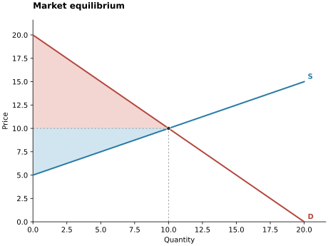
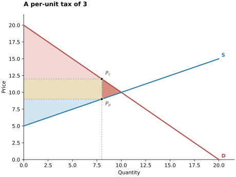
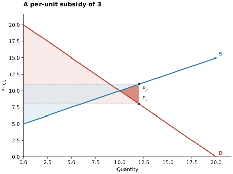
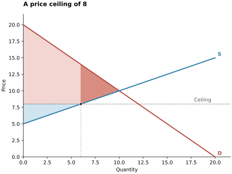
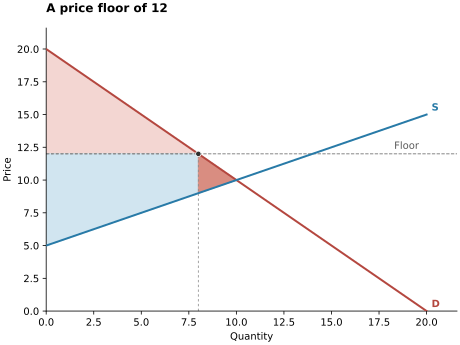
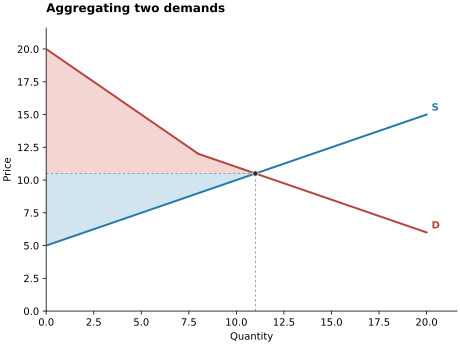

Market examples
===============

These six examples use the same market: demand is :math:`P=20-Q` and supply
is :math:`P=5+0.5Q`. Consumer surplus is shaded pale red, producer surplus pale
blue, government revenue pale gold, and deadweight loss salmon. A subsidy is a government
expenditure, so its revenue is negative.

The figures use the defaults from ``market.plot(surplus=True)``. The source
example checks each price, quantity, and welfare component against a
hand-calculated answer before saving a figure.

Market equilibrium
------------------

.. code-block:: python

   from freeride import Demand, Market, Supply

   demand = Demand.from_formula("P = 20 - Q")
   supply = Supply.from_formula("P = 5 + 0.5Q")
   market = Market(demand, supply)
   ax = market.plot(surplus=True)

The equilibrium is :math:`P=10`, :math:`Q=10`. Consumer surplus is 50 and
producer surplus is 25, giving total surplus 75.

A tax and a subsidy
-------------------

.. code-block:: python

   taxed = Market(demand, supply, tax=3)
   taxed.plot(surplus=True)

   subsidized = Market(demand, supply, tax=-3)
   subsidized.plot(surplus=True)

A tax of 3 reduces quantity to 8. Consumers pay 12, producers receive 9, and
government revenue is 24. A subsidy of 3 increases quantity to 12. Consumers
pay 8, producers receive 11, and government expenditure is 36. Each policy
causes deadweight loss of 3. Use ``p_consumer`` and ``p_producer`` when a policy
creates two prices.

Price controls
--------------

.. code-block:: python

   ceiling = Market(demand, supply, ceiling=8)
   ceiling.plot(surplus=True)

   floor = Market(demand, supply, floor=12)
   floor.plot(surplus=True)

The ceiling at 8 gives quantity supplied 6 and quantity demanded 12: a shortage
of 6 and deadweight loss of 12. The floor at 12 gives quantity demanded 8 and
quantity supplied 14: excess supply of 6 and deadweight loss of 3.

Welfare assumes efficient rationing: available units go to the highest-value
buyers and lowest-cost sellers. A floor does not imply government purchases.

Aggregate demand
----------------

.. code-block:: python

   second_demand = Demand.from_formula("P = 12 - Q")
   aggregate = Market(demand + second_demand, supply)
   aggregate.plot(surplus=True)

Addition sums quantities at each price. The aggregate demand has a kink at
:math:`P=12`, where the second group begins to buy. Equilibrium is
:math:`P=10.5`, :math:`Q=11`, with consumer surplus 46.25 and producer surplus
30.25.

